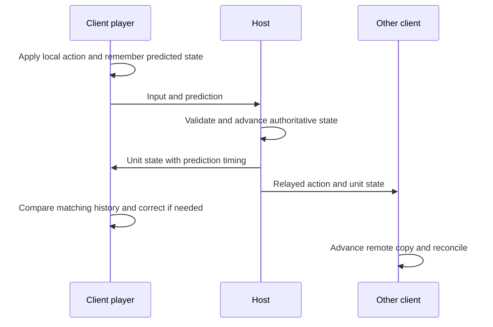

# Following a player action across the network

The example is a client player moving forward while the host and another
player observe them. Read [input](settings_input_and_menus.md) and
[objects](objects_and_gameplay.md) first. The detailed reference is
[NETCODE.md](../../port/linux/NETCODE.md); this chapter supplies a route
through its implementation rather than reproducing its protocol catalogue.

## Reading route

| Order | Source and names to find | What to establish |
| --- | --- | --- |
| 1 | [network_game_manager.c](../../source/networking/network_game_manager.c), [network_server_manager.c](../../source/networking/network_server_manager.c) | Session/player admission and teardown. |
| 2 | [network_distributed.h](../../port/linux/game/network_distributed.h) | Message kinds and shared contracts between the distributed modules. |
| 3 | [network_distributed.c](../../port/linux/game/network_distributed.c): `network_distributed_tick`, `distributed_client_send_inputs`, `distributed_client_send_predictions` | What the client sends after advancing its player. |
| 4 | The same file: `distributed_take_prediction`, `distributed_correct_own_unit`, `network_distributed_handle_message` | Validation, host acceptance and local correction. |
| 5 | [network_objects.c](../../port/linux/game/network_objects.c), [network_damage.c](../../port/linux/game/network_damage.c) | Object lifetime, inventories, damage and hit reports. |
| 6 | [third_person_protocol.c](../../port/linux/game/third_person_protocol.c), [third_person_protocol.h](../../port/linux/game/third_person_protocol.h) | GulchCE-only camera admission; Xbox, CE and MCC share OpenCE admission in Crossplay mode. |

## Joining creates a session, not just a socket

A listing or advertisement tells a client about a game. Admission still
checks compatibility, available slots and session state. The networking
managers handle players joining and leaving; a player must acquire a
consistent identity before other packets can safely refer to them.

Joining a running game adds further work: load the map, establish the
host's time, receive existing objects and game state, and become ready.
The [joining reference](../../port/linux/NETCODE.md#joining-a-game-in-progress)
explains the sequence and timeout rules. A connected peer that has not
loaded is not yet able to consume all ordinary gameplay messages.

When diagnosing a join failure, separate discovery, admission, content
matching, loading and synchronization. Reaching one of these stages does
not establish that the next succeeded.

## Input and predicted position are different messages

The client's [input path](settings_input_and_menus.md) produces its player's
action. It advances its own player promptly instead of waiting for a round
trip. After the host's initial snapshot finishes, `network_distributed_tick`
records its own positions, sends inputs and sends predictions, then performs
other client network work. The checkpoint boundary below explains the brief
send pause while a snapshot is arriving.

The input says what the player attempted. The prediction says where the
client's simulation put them. The host does not grant authority simply
because it receives a plausible-looking position: `distributed_take_prediction`
checks movement against its own state and permitted tolerances. The host
applies accepted predictions at its tick boundary. It also relays the
players' actions and sends authoritative unit state to clients.

This diagram describes dependencies, not a promise that every message
arrives or is sent to every peer at the same rate. Distance, visibility,
batching and message type affect transmission frequency.

When scripts disable player input, relayed actions no longer describe the
player unit's pose. A late join can attach the unit before the input-disabled
presentation arrives, leaving a locally changed aim that inhibition then keeps.
Read `distributed_scripted_pose_from_unit`, `distributed_unit_state_write`,
`distributed_unit_state_read`
and `distributed_scripted_pose_apply` in `network_distributed.c`: the host sends
desired facing/aim/look and current aim/look as separate directions while input
is inhibited or the unit is suspended. A body's forward axis is not a substitute
for any of those directions. Complete bounded decoding and direction validation
precede application to the matching live unit. The host rejects client
predictions carrying scripted pose or suspension fields; sharing a decoder
does not grant clients authority over those fields.

For example, during a cinematic the host can retain its current aim while a
script has already requested a different direction. Both values must survive a
late join. The suspension flag also follows the host. Scripted correction does
not reuse ordinary input-prediction history, and it can reconcile orientation
even when positions agree. The existing co-op BSP guard still protects a local
player whose host has changed BSP. Normal controllable input omits the extra
vectors and retains its prediction path. This shared engine contract applies
independently of map family; it is not an MCC data conversion.

[Scripted-pose tests](../../tools/test_scripted_player_pose.py) exercise the
actual codec, malformed/truncated input, unchanged ordinary wire data and a
stationary turn. The [milestone evidence](../mcc_refactor_validation.md#milestone-15-mcc-hud-corrections-and-shared-cinematic-aim)
distinguishes the controlled tests from native/browser runtime observations.

A client with a custom firing position, such as a VR hand, can send OpenCE's
optional fire-origin message. In `network_damage_handle_fire_origins`, the host
accepts positions only for players owned by that client and within a bounded
reach. The hit-report path checks freshness, hand position and line of sight;
`network.fire_origins` controls whether this can admit a hit the eye cannot see.
MCC's separate message numbers and admission revision are recorded in
[NETCODE.md](../../port/linux/NETCODE.md), preserving OpenCE's message 93.

Co-op presentation has its own authority path. In
[network_coop.c](../../port/linux/game/network_coop.c),
`client_presentation_apply` gives the host's scripted cutscene camera
precedence over dead-player spectating, including vehicle insertion scenes.
`camera_object_offset` follows the client's local copy of the filmed object.
When scripts release the camera, the normal spectating path applies again;
`coop_spectate_nothing_to_watch` retains the host view when nobody is alive
to watch. This is source behavior, not evidence of every campaign cutscene
having been played through.

## Compare states from the same time

Suppose the host replies about tick T, but the client has already moved on.
Comparing the host's old position directly with the client's current
position would mistake legitimate later movement for an error.

`distributed_correct_own_unit` looks up the recorded local position for
the prediction time, checks both time and unit identity, and measures the
host's difference from that historical position. When correction is needed,
it applies the difference to the current position and adjusts the stored
history accordingly. This path preserves movement performed since T; it
is not a general rewind-and-replay implementation of every game object.

The code contains special cases that carry meaning. A co-op player should
not be moved into a BSP the client has not loaded. A player still supported
by the same elevator can have a small vertical phase difference without
having made an invalid jump. Read those guards before simplifying the
position comparison.

A client can also lose simulation time during a loading stall. Follow
`network_game_client_handle_message_server_game_update` in
[network_client_message_handler.c](../../source/networking/network_client_message_handler.c),
then `network_game_client_handle_game_update` in
[network_client_manager.c](../../source/networking/network_client_manager.c),
and `game_time_synchronize_distributed` / `game_time_update` in
[game_time.c](../../source/game/game_time.c). Only a decoded reliable update
from the selected host while in game supplies this target; distributed
datagram timestamps do not set it.

For example, a client eight ticks behind remembers the host's timestamp and
can run two ticks on a frame that normally runs one. Every added tick executes
the normal simulation, interpolation snapshot and network publication. Extra
work is capped at the frame's ordinary tick count and 30 total ticks, never
past the observed target solely for catch-up. The fractional frame remainder
is unchanged. A repeated or older target adds no new time; this is not an
extrapolated moving clock. Local and host clocks, menus, startup holds, pauses
and MCC zero speed do not gain extra ticks. MCC's approved nonzero speed
determines the ordinary budget before catch-up.

The target is transient, outside saved game state, and clears on initialization,
map disposal, game end and explicit clock replacement. Co-op checkpoint recovery
keeps the host clock monotonic; the target carries no object epoch or saved
world data. Initial synchronization and the existing jump for delays over one
second remain separate. The [frame-clock regression](../../tools/harness/tests/test_game_time_sync.py)
exercises the actual handler and tick loop, including stale targets, work bounds,
pause/speed transitions and lifecycle resets. Runtime results remain separate
evidence; passing this harness does not establish all network compatibility.

## Authority also governs hits and object lifetime

Movement prediction does not give the client authority over kills or
pickups. `network_damage.c` reports a local player's hits and checks them
on the host against ownership, weapon/rate rules, target history and other
constraints. The host deals damage. Clients replay the corresponding
presentation, with special handling for deaths and authoritative state.

A projectile may remain after its firing object is deleted. The player lookup
`get_player_index_from_object_or_parents` in
[damage.c](../../source/objects/damage.c) therefore uses a checked object lookup
before following a non-unit's parent. An expired datum (including a slot reused
by a different object) yields no player for the gametype multiplier lookup.
It does not erase the damage payload's separate player/team attribution or
change host admission. The [owner lookup tests](../../tools/harness/tests/test_damage_owner_lookup.py)
cover live units, AI, parent chains, deletion and slot reuse.

OpenCE's host also checks a reported point hit against level geometry in
`distributed_report_line_of_sight`. For example, a shot reported through
a solid wall is refused if no eligible recent shooter position has a clear
route to the target. The check uses bounded history and trace counts;
vehicle muzzles require a clear segment from the recorded eye position.
`distributed_stuck_detonation` allows a matching host-recorded attached
projectile to detonate after its victim moves behind cover, consuming that
attachment once. Melee, collision and area damage retain their existing
admission checks. The history and attachment ledger reset for each new game.
The [sight tests](../../tools/harness/tests/test_reported_hit_sight.py)
exercise extracted admission functions with controlled collision results,
including deliberate broken variants; they do not simulate every map's
geometry or replace real combat checks.

`network_objects.c` creates, deletes and reconciles replicated objects.
The host tick sends object changes before messages that depend on those
objects. Kill statistics and damage/state ordering matter too: receiving
a reference before the referred-to object or announcing a kill before its
statistics can produce an inconsistent client even if each packet is valid.

An inventory can arrive in an unreliable datagram before its unit or weapons
arrive on the reliable stream, despite the host's send order. OpenCE's
`distributed_client_retry_inventory` retains the latest inventory for each
unit in a bounded queue. `distributed_client_apply_retried_inventories`
checks it each client tick, applies entries once their objects
exist, and expires entries after `EMPTY_INVENTORY_TICKS`. A checkpoint clears
the queue in `network_objects_reverted`; `network_objects_new_game` uses that
same reset. For example, a newly spawned player
can receive their weapon inventory before the weapon object; retaining it
lets the client equip that weapon when it arrives without granting the
client authority over inventory. The
[retry tests](../../tools/harness/tests/test_retried_inventories.py) exercise
late units and weapons, replacement, capacity, forgetting and expiry using
extracted engine functions and deliberate broken variants.

A checkpoint can restore an earlier living object with the same full handle
that identifies its corpse on a client. Follow `network_coop_reverted` in
[network_coop.c](../../port/linux/game/network_coop.c), then
`network_distributed_reverted` in `network_distributed.c` and
`network_objects_host_reverted` in `network_objects.c`. This is shared network
co-op behavior, independent of camera policy or map family.

Every distributed header includes a world epoch: a host-owned counter outside
checkpointed game state. `network_distributed_reverted` advances it and
`distributed_restore_checkpoint` clears old prediction, recovery, damage and
actor state. `distributed_message_epoch_valid` accepts a new epoch only from
an exact, standalone reliable host boundary. Gameplay messages with another
epoch are rejected before simulation clocks, stale tracking or handlers run.
Thus an old reliable kill cannot kill a restored object merely because its
handle matches.
Late-join readiness can request the current boundary within the existing
resend limit; it cannot adopt an epoch or authorize gameplay itself.

Read `network_objects_client_asked` next. Its reliable snapshot sends the
boundary, object descriptions, ordinary inventories, then an exact
`objects_synchronized` end marker. `distributed_host_send_inventories_to_machine`
includes empty inventories of living units. For example, a healthy retained
unit may still carry a weapon picked up after the saved checkpoint; explicit
empty slots remove it even after the periodic sender's empty-inventory window
has elapsed. MCC's additional grenade slots and campaign state retain their
separate periodic synchronization in `mcc_network.c`.

Before the end marker, the client accepts ordered object descriptions and
ordinary inventories, while refusing other gameplay and suppressing outgoing
gameplay in `distributed_fill_header`. `network_objects_client_tick` continues
readiness, inventory retries and cleanup bookkeeping, but uses
`distributed_checkpoint_ready` to postpone local inventory and vehicle
prediction notes. Old replicas therefore cannot supply new-world input or
make the restored inventory look like an acknowledgement of a local shot.
The marker confirms ordered delivery; failed object creation still uses the
existing retry path rather than being declared successful.

Client simulation continues during the transfer, so it can create projectiles,
delayed effects and hit reports from replicas that are only partly restored.
On the first validated ordered host end marker for the current epoch,
`distributed_message_epoch_valid` retires those projectiles and effects with
`network_objects_discard_client_effects`, clears hit queues through
`network_damage_new_game`, and clears provisional input, prediction and send
histories through `distributed_reset_checkpoint_state(FALSE)` before ordinary
gameplay messages resume. This preserves the object descriptions and inventories
already applied from the snapshot. It also retains sender and per-message receive times, so
older datagrams in the same epoch remain stale. A duplicate end marker does
not repeat this cleanup or erase current gameplay.

In `distributed_client_create`, only the first validated description for an
object slot in the new epoch may replace a same-handle dead co-op unit with
the host's live copy. `distributed_client_reuses_object` applies that rule;
`distributed_handle_unit_state` subsequently binds the player. A later live
description in the same epoch cannot undo a newer death. Another checkpoint
explicitly renews eligibility. Existing healthy replicas retain their normal
reuse path.

The initial boundary reset also calls `network_objects_discard_client_effects`:
old client projectiles and effects with delayed object or damage parts are deleted
through their existing lifecycle. Host checkpoint projectiles remain intact.
This boundary does not comprehensively reset or reconstruct authored HUD,
navigation-point and attachment caches. Those pre-existing presentation paths
need separate evidence before claiming complete authored checkpoint rollback.

The [checkpoint regression](../../tools/test_coop_checkpoint_recovery.py) and
[epoch dispatch tests](../../tools/test_checkpoint_epoch.py) exercise actual
engine functions. The [original investigation](../mcc_refactor_validation.md#stage-10-shared-checkpoint-recovery-investigation)
retains the old default-profile failure and the earlier camera-only limits;
the [shared recovery validation record](../mcc_refactor_validation.md#stage-10-shared-checkpoint-recovery-fix)
reports checks completed for the new contract, separately from source intent.

## Transport has its own contracts

Inputs are sent unreliably, with recent button history repeated to tolerate
loss without waiting for retransmission. Important lifecycle events use
reliable connections. Unreliable updates carry time information so stale
data can be rejected. Reliability does not replace size, sender, direction,
rate or index validation.

Internet play uses the P2P transport around this gameplay model. Native
[p2p_webrtc.c](../../port/linux/src/p2p_webrtc.c) and browser
[web_p2p.c](../../port/web/src/web_p2p.c) connect through WebRTC data channels;
the browser's socket constraints change transport implementation, not who
decides damage. See [Transport](../../port/linux/NETCODE.md#transport) before
following packet details into those files.

The transport also owns its worker lifetimes. In
[p2p.c](../../port/linux/src/p2p.c), `p2p_initialize` registers `p2p_shutdown`
before creating the worker. Shutdown requests a stop under `p2p_lock`, waits
outside that lock for both the tunnel and UPnP workers, then withdraws the
public listing and any idle router mapping. Upstream bounds each exit wait
to three seconds; a worker that exceeds it may still be running as the C runtime
closes its streams. This applies to every map family without changing packets
or simulation. Completed UPnP workers are also reaped before
renewal. [Lifecycle regressions](../../tools/test_p2p_shutdown.py) execute the
actual functions with controlled OS threads and failure injection.

`posix_upnp_cancel` in [posix_upnp.c](../../port/linux/src/posix_upnp.c) is a
process-exit latch, checked between discovery, mapping scans and port retries.
It cannot interrupt an active miniupnpc request. Discovery asks for two
seconds, connection waits use three seconds and HTTP reads use five seconds
per read; repeated reads and multiple devices mean these are not a total
request deadline. The bounded exit wait does not guarantee an active request
has finished. Browser UPnP remains disabled, with a no-op cancellation stub.

## GulchCE compatibility and teardown

Crossplay uses upstream OpenCE protocol 43 for Xbox, Custom Edition and MCC
maps. Map-vote messages remain IDs 94-95; checkpoint recovery is 96; MCC owns
its upstream gameplay, sharing, admission and loading message IDs. MCC content
identity and loading checks remain active, but there is no GulchCE-specific MCC
capability, network version or join envelope.

After decoding an ordinary join, the host checks its appended shared version
before token, ban and player-slot admission. The
[join codec test](../../tools/test_join_protocol.py) checks that old and truncated
requests cannot omit this field. `test_mcc_protocol.py` pins the complete
upstream protocol 43 manifest and exercises host admission. MCC-only gameplay
messages must still not execute on Xbox or CE maps; map-family isolation is
independent of protocol compatibility.

For dedicated hosting, start at [dedicated_server.md](../dedicated_server.md),
then read `server_director.c` for rotation and session ownership and
`server_commands.c` for administration. These upstream paths retain the same
ordinary host authority and admission checks.

The Session Options selector chooses Crossplay (`opence_crossplay`) or GulchCE
Only (`gulchce_third_person`). Crossplay disables multiplayer shoulder-camera
behavior. GulchCE Only uses camera protocol 32744, an additional shoulder relay
byte and a mandatory kind 102 join envelope around the ordinary join. It is the
same contract for all map families. Forced Off remains a camera session and
does not relax admission.

Read [third_person_protocol.c](../../port/linux/game/third_person_protocol.c):
`third_person_protocol_join` and `third_person_protocol_unwrap` bound and
validate camera admission. The shared join send/dispatch hooks are necessary
because the engine owns those boundaries. Host create/open/dispose hooks own
the session lifetime; client join/disconnect hooks clear prior permissions.
A camera server requires the envelope before the ordinary token, bans, slots
and map-content checks. A Crossplay server uses the ordinary shared-version admission path.
The selected mode cannot change after the lobby opens. See the
[camera walkthrough](third_person.md#session-compatibility) for behavior,
state ownership and tests. Public listings retain the common discovery
format; the subsequent advertisement and handshake determine compatibility.

## Evidence and useful checks

The original Xbox lockstep model is replaced by the port's distributed
netcode. The core host/client behaviour above comes from that port; the MCC
admission boundary is GulchCE-specific.
[test_elevator_prediction.py](../../tools/harness/tests/test_elevator_prediction.py)
and [test_elevator_correction.py](../../tools/harness/tests/test_elevator_correction.py)
exercise production movement paths in controlled conditions.
[test_server_teardown.py](../../tools/harness/tests/test_server_teardown.py)
checks session cleanup. These were inspected, not run for this chapter.

[net_compare.py](../../tools/net_compare.py) runs builds together and judges
their logs; [test_net_compare.py](../../tools/test_net_compare.py) tests the
judge itself with constructed logs. Passing the latter does not establish
that two game builds interoperate. Real changes need appropriate host/client,
late-join, loss, teardown and native/browser transport checks. The
[testing chapter](platforms_and_testing.md) explains how to report their limits.

Continue with [maps and resources](maps_and_resources.md), or return to the
[guide](README.md).
